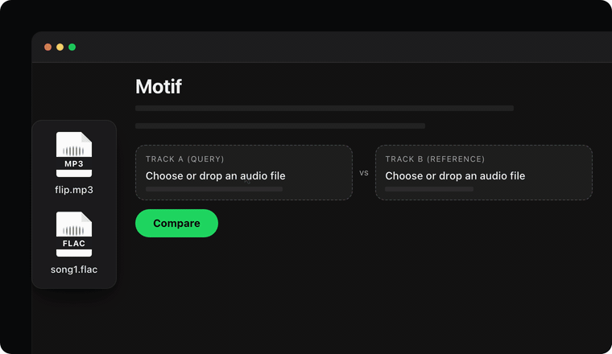

# Motif (web)

Pairwise audio comparison in the browser. Given a query and a reference recording,
Motif reports whether they share audio (same recording, sample, re-release) via
landmark fingerprinting, and whether they are musically similar (same melodic and
harmonic content, possibly transposed or at another tempo) via chroma alignment.

The engine is C11 compiled to WebAssembly. Decoding and analysis run client-side;
no audio leaves the browser.

**Live:** https://jeffasante.github.io/motif-web/



## Pipeline

```
file -> Web Audio decode -> mono (mean of channels) -> resample to 22050 Hz (float32)
     -> SHA-256 of the original bytes
     -> motif_compare()                                             [WASM]
          validate: 1 s <= duration <= 1800 s, peak >= -90 dBFS
          STFT peaks -> landmark hashes -> offset clustering     => shared_audio
          chroma -> transposition x tempo window search          => musical_similarity
          per-file key and tempo
     -> JSON report (assessment, evidence, diagnostics)
```

## Shared-audio detection

Constellation-style landmark fingerprinting.

| Stage | Method and parameters |
|---|---|
| Spectrogram | `n_fft` 2048, hop 256 (11.6 ms), periodic Hann; power in dBFS, scaled so a full-scale sine reads 0 dB |
| Peak picking | 100–5000 Hz, ≥ −60 dBFS, local maximum over ±10 frames × ±10 bins; strongest 50 peaks kept per second |
| Hashing | each anchor paired with up to 10 targets 1–64 frames ahead and within ±100 bins; 32-bit hash `f1 << 18 \| f2 << 8 \| Δt` (bins, frames), stored with the anchor frame |
| Lookup | reference hashes sorted; each query hash resolved by binary search; every match yields `offset = t_ref − t_query` |
| Clustering | offsets scored by pair count within ±2 frames; for each candidate offset (strongest first), unused pairs in tolerance are ordered by query time and split at gaps > 2 s |
| Decision | a run of ≥ 40 aligned hashes is a segment; up to 5 segments, ranked by aligned count |

Matching is done at speed ratio 1.0 only, so pitch-shifted or time-stretched
samples do not align. The `pitch_sweep` diagnostic re-aligns the query at
−6…+6 semitones (pitch-only and pitch+speed) for inspection; it does not affect
the assessment.

## Musical similarity

| Stage | Method and parameters |
|---|---|
| Chroma | STFT `n_fft` 4096, hop 1024; bins in 65–2100 Hz mapped to nearest pitch class (A4 = 440 Hz); power averaged into 0.25 s frames, compressed with `log1p(1000·x / peak)`, L2-normalised |
| Standardisation | each frame mean-centred and L2-normalised, so frame dot products are cosine similarities |
| Search space | query time-stretched (linear interpolation) by r ∈ {0.8, 0.9, 1.0, 1.1, 1.25} × 12 circular pitch-class rotations |
| Window score | 8 s query windows (32 frames), 2 s hop; score at a reference offset = mean of the similarity-matrix diagonal, computed from cumulative diagonal sums (O(n·m) per rotation and ratio), max-pooled over ±1 reference frame |
| Decision | score ≥ 0.8 for ≥ 3 consecutive windows at the same offset; the best run is reported with `mean_similarity`, `transposition_semitones`, `tempo_ratio` |

## Key and tempo

- **Key:** time-averaged chroma, Pearson-correlated with the 24 rotated
  Krumhansl–Kessler major/minor profiles. Reported when the best correlation
  is ≥ 0.5, together with the runner-up.
- **Tempo:** onset envelope from half-wave-rectified log-spectral flux
  (`n_fft` 1024, hop 256) minus a 0.5 s moving average; normalised autocorrelation
  over lags for 60–200 BPM, parabolic interpolation of the peak. Half and double
  tempo are listed as alternatives when in range. Peak strength < 0.1 is marked weak.

## Assessment

Each comparison gets exactly one label:

| Label | Condition |
|---|---|
| `identical_file` | SHA-256 of both inputs is equal |
| `not_compared` | an input failed validation (reason in its `error`) |
| `shared_audio` | at least one fingerprint segment |
| `musical_similarity` | no shared audio, but a chroma run passed the threshold |
| `no_evidence` | neither detector fired |

The label carries a fixed `statement`. Shared audio does not establish which
recording came first or whether use was licensed; musical similarity is a lead
for a listener, not a finding.

## Report

Schema `1.0`, engine `0.1.0`, `fingerprint-1`, `musical-1`.

```
schema_version, motif_version, command
analysis       engine, decoder, features (all fingerprint/chroma/key/tempo params), thresholds
query          input, status, sha256, duration_seconds, key, tempo, error
reference      (same)
relationship
  assessment          label, statement
  shared_audio        detected, speed_ratio, query_hashes, matching_hashes,
                      segments[ query_start_seconds, query_end_seconds,
                                reference_start_seconds, reference_end_seconds,
                                offset_seconds, aligned_hashes ]
  musical_similarity  detected, reason,
                      best { query/reference start/end seconds, mean_similarity,
                             transposition_semitones, tempo_ratio, windows }
diagnostics
  pairs                   matched hash pairs (<= 4000 points, pairs_stride)
  offset_histogram        <= 1500 bins, best offset and aligned count
  per-second              hashes, matched, aligned, peaks found, density cap
  pitch_sweep             aligned count at -6..+6 semitones
  chroma_transposition    best score per rotation
  chroma_tempo            best score per stretch ratio
```

`shared_audio`, `musical_similarity` and `diagnostics` are `null` when the files
were not compared.

## API

C (exported from the WASM module):

```c
char *motif_compare(const float *query, size_t n_query,
                    const char *query_name, const char *query_sha256,
                    const float *reference, size_t n_reference,
                    const char *reference_name, const char *reference_sha256,
                    const char *decoder);   /* JSON; release with motif_free */
void *motif_malloc(size_t n);
void  motif_free(void *p);
```

Samples are mono float32 at 22050 Hz. Returns `NULL` on allocation failure.

JavaScript wrapper (`motif.js`):

```js
import { compare, SAMPLE_RATE } from "./motif.js";   // SAMPLE_RATE === 22050

const report = await compare(
  { samples: queryF32, name: "a.wav", sha256: hashA },
  { samples: refF32,   name: "b.wav", sha256: hashB },
  "Web Audio",          // decoder description, echoed in the report
);
report.relationship.assessment.label;
```

`compare` copies both buffers into WASM memory, calls `motif_compare`, parses the
result and frees every allocation.

## Building

Requires Emscripten (`emcc` on `PATH`).

```sh
sh build.sh
```

which runs:

```sh
emcc -std=c11 -O2 -Wall -Wextra -D_DEFAULT_SOURCE src/*.c \
  -sMODULARIZE=1 -sEXPORT_ES6=1 -sEXPORT_NAME=createMotifEngine \
  -sENVIRONMENT=web,node -sALLOW_MEMORY_GROWTH=1 -sMAXIMUM_MEMORY=4GB \
  -sEXPORTED_FUNCTIONS=_motif_compare,_motif_malloc,_motif_free \
  -sEXPORTED_RUNTIME_METHODS=UTF8ToString,stringToNewUTF8,HEAPF32 \
  -o motif_engine.js
```

Serve over HTTP (browsers will not instantiate WASM from `file://`):

```sh
python3 -m http.server 8765 --bind 127.0.0.1
```

The engine depends only on libc and libm, uses its own real FFT, and allocates
from a per-call arena released before `motif_compare` returns.

## Limitations

- Input formats are whatever the browser's decoder supports (WAV, MP3, FLAC
  broadly; AAC/M4A varies).
- All parameters are fixed at the defaults above.
- Max 1800 s per input; both decodes are held in memory
  (~159 MB of float32 per 30 min input at 22050 Hz).
- Fingerprinting assumes unmodified speed and pitch; short, pitch-shifted,
  time-stretched or heavily processed samples, and samples buried in dense mixes,
  can fall below the 40-hash threshold.
- `no_evidence` means neither detector fired, not that the recordings are unrelated.
